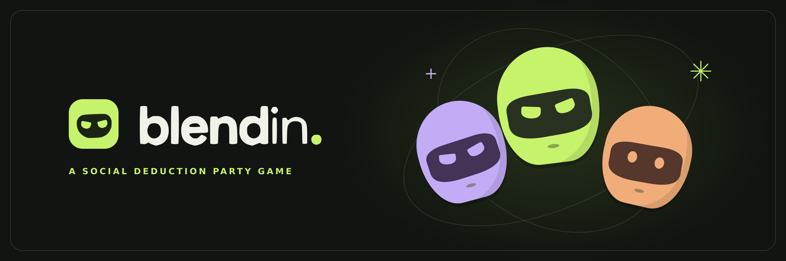

# Blend In

**Trust your friends. Question everything.**

Blend In is a browser party game for **3–20 players**. Everyone knows the secret word except the Imposter. Give just enough away to prove you know it, read your friends’ answers, and vote before the Imposter talks their way out of it.

**[Play Blend In →](https://blendin.party/)**

## How to play

1. Create a lobby and share the invite link or room code with your friends.
2. Pick a mode and a word pack. You can use a built-in pack or bring your own words.
3. Talk it out in person or over your favorite voice chat, then vote for the Imposter.
4. If **Last Chance** is enabled, a caught Imposter can steal the round by guessing the secret word.

| Mode | How it works |
| --- | --- |
| **Freestyle** | Talk freely about the secret word without saying it. |
| **Describe** | Answer shared multiple-choice questions about the word, compare answers, and decide who’s bluffing. |

## What this repo is for

This is the public home for **Blend In updates, bug reports, and feature ideas**. The game is hosted at [blendin.party](https://blendin.party/); this repository does not contain the game’s source code.

## Feedback

Open an issue to report a bug or suggest a feature. For bugs, include your browser and device, the game mode, what you expected, and the steps that led to the problem. For feature ideas, tell me how you’d use them in a round.

Made by **Dmor**.